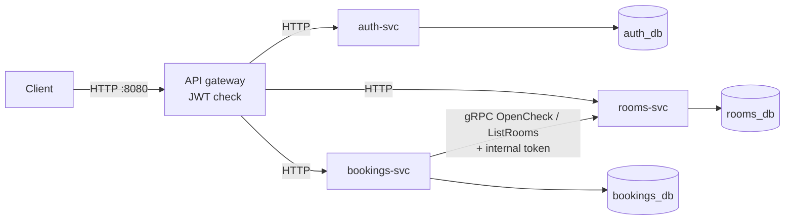

# StudyRoom: Microservices Booking System

A study-room booking and scheduling system written in Go and split into microservices. Clients talk to an HTTP API gateway, and the services check room availability with each other over gRPC. Each service runs in its own container and has its own database.

This is the microservices half of a comparison. The same system is built as a single layered service in [studyroom_booking](https://github.com/farbod-bigdeli/studyroom_booking).

## Architecture



| Service | Port | Responsibility |
|---|---|---|
| `api-gateway` | 8080 (public) | Routing, JWT validation, admin checks |
| `auth-svc` | 8081 | Registration and login. Hashes passwords with bcrypt and issues HS256 JWTs |
| `rooms-svc` | 8082 (HTTP), 9002 (gRPC) | Rooms and schedules. Answers availability checks over gRPC |
| `bookings-svc` | 8083 | Bookings, cancellations, waitlist and search. Calls `rooms-svc` over gRPC |

All three databases run on one MongoDB container (`auth_db`, `rooms_db`, `bookings_db`). The gRPC contract is in `proto/room.proto`. `bookings-svc` sends a shared internal token with every gRPC call, and `rooms-svc` rejects availability checks that don't carry it.

## API (through the gateway)

| Method | Path | Auth | Description |
|---|---|---|---|
| POST | `/register` | none | Create an account |
| POST | `/login` | none | Log in and receive a JWT |
| GET | `/me` | JWT | Current user |
| GET | `/search?start=&end=&min_capacity=` | JWT | Rooms open in a time window |
| POST | `/bookings` | JWT | Book a room |
| DELETE | `/bookings/:id` | JWT | Cancel a booking |
| POST | `/waitlist` | JWT | Join a room's waitlist |
| POST | `/admin/rooms` | JWT, admin | Create a room |
| GET | `/admin/rooms` | JWT, admin | List rooms |
| POST | `/admin/rooms/:id/schedules` | JWT, admin | Set a room's schedule |

## Run

Requires Docker and Docker Compose. `protoc` is only needed if you change the `.proto` files.

```bash
docker compose up -d --build
docker compose ps
```

The gateway listens on http://localhost:8080, and Mongo Express on http://localhost:8081.

The secrets in `docker-compose.yml` (`JWT_SECRET`, `INTERNAL_TOKEN`, the MongoDB password) are development defaults. Replace them before running this anywhere else.

## Load testing

`test.sh` logs in, then runs [wrk](https://github.com/wg/wrk) against `/search` through the gateway with increasing thread and connection counts. If wrk isn't installed, it uses the `williamyeh/wrk` Docker image. Run the same script against the layered version to compare the two architectures.

```bash
./test.sh
```
